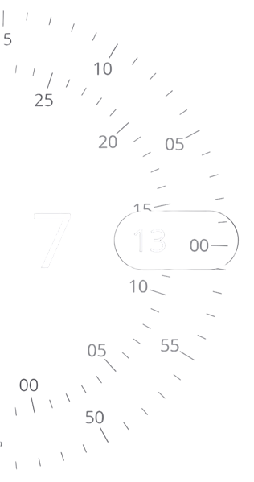
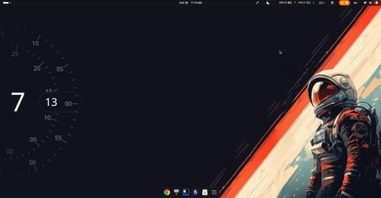

<h1 align="center">ZCLOCK</h1>
<h3 align="center">Gnome clock extension with smooth UI/UX </h3><br>

<p align="center">  </p>

<p align="center">
  
</p>


<p align="left">  </p>

<p align="left">  </p>


## Install

To install the latest version of the extension head to the Official GNOME Extensions website.

<a href="https://extensions.gnome.org/extension/7831/zclock/">
  
</a>

### Install directly from GitHub

This downloads the latest `main` source, packages it, and installs the extension.
It requires `curl`, `tar`, and `gnome-extensions`.

```sh
set -euo pipefail
tmpdir="$(mktemp -d)"
curl -fL https://github.com/lorens-osman-dev/zclock/archive/refs/heads/main.tar.gz |
  tar -xz --strip-components=1 -C "$tmpdir"
(
  cd "$tmpdir"
  gnome-extensions pack --force --out-dir="$tmpdir" \
    --extra-source=src --extra-source=LICENSE --extra-source=README.md .
)
gnome-extensions install --force "$tmpdir/zclock@lorens.shell-extension.zip"
rm -rf "$tmpdir"
```

On Wayland, log out and back in after installing, then enable and configure it:

```sh
gnome-extensions enable zclock@lorens
gnome-extensions prefs zclock@lorens
```


## Technical information

For architecture, rendering and animation details, development checks, and
testing notes, see [technical_info.md](technical_info.md).


## Support

<a href="https://www.buymeacoffee.com/lorens" target="_blank"></a>